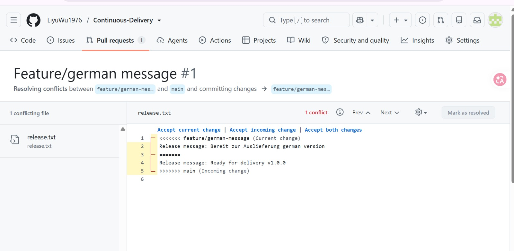
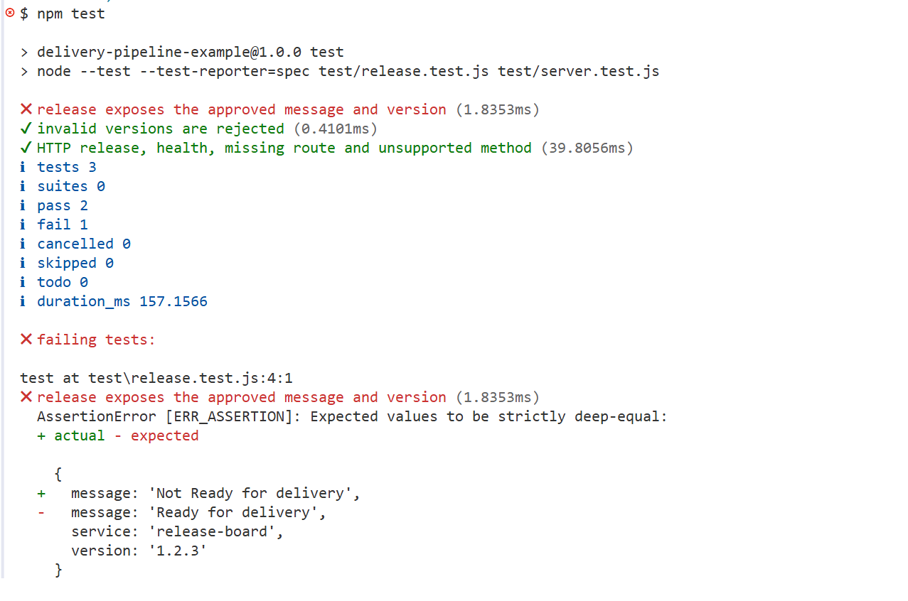
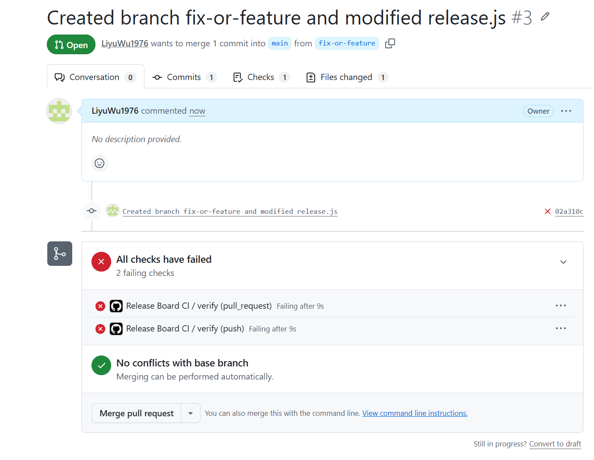

# Kurze Reflexion zur ersten Einheit
Formulieren Sie zum Abschluss 3–5 zusammenhängende Sätze:
Welcher Unterschied zwischen Integration, bereitstellbarer Version und automatischer Produktionsbereitstellung ist Ihnen am Beispiel klar geworden?

Successful integration initially only means that changes have been merged. 
A deployable version additionally requires passing checks and a built, reproducible artifact.
Automated production deployment pushes this verified result live without requiring manual approval.

Welchen Fehler hat Git erkannt und welchen Fehler erst der Test?
Git detected a conflict because both branches had modified the same line in `release.txt` in different ways; however, Git cannot determine whether a conflict resolution satisfies the functional requirements of both sides, and the application test does not check `release.txt` at all. 

Tests discover semantic runtime errors (indicated by a failed test run resulting from broken interface logic).

Welche konkrete Maßnahme würden Sie in Ihrem nächsten Projekt übernehmen?
For my next project, I will implement branch protection rules with mandatory CI status checks as a standard procedure, ensuring that a merge into the main branch is only permitted once all automated tests have passed successfully.

Belegen Sie die Aussage mit Ihrem Konflikt oder dem roten/grünen Testlauf. Bis 19.10.2026: persönliches Übungsrepository, gewählter Hauptstack und dokumentierter lokaler Start. Java/Maven oder Node.js genügt. Die Reflexion fließt als nachvollziehbare Begründung in die zugehörige praktische Arbeit ein und bildet keinen zusätzlichen Dokumentationsanteil.

Ergänzen Sie den gemeinsamen GitHub-Link und Ihre beiden Pull Requests. Kennzeichnen Sie, welche Nachweise lokal vorliegen und welche tatsächlich in GitHub Actions ausgeführt wurden. 

## Nachweise und eigene Übung

- Gemeinsames GitHub-Repository: **https://github.com/LiyuWu1976/Continuous-Delivery.git**
- Pull Request von Person A (`feature/version`): **https://github.com/LiyuWu1976/Continuous-Delivery/pull/**
- Pull Request von Person B (`feature/german-message`): **https://github.com/LiyuWu1976/Continuous-Delivery/pull/1**
- Konfliktnachweis: ****
- Roter/grüner Testlauf: **

**

Kennzeichnen Sie nur Nachweise als „in GitHub Actions ausgeführt“, wenn der entsprechende Lauf im Repository tatsächlich stattgefunden hat. Ein lokaler Testlauf und ein vorhandener Workflow ohne ausgeführten Lauf sind kein Actions-Nachweis.
